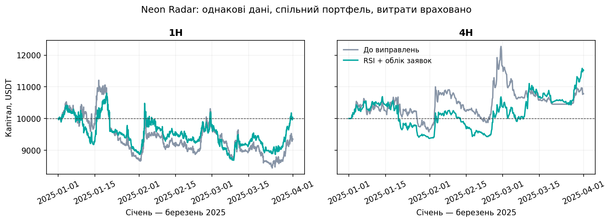

# Neon Radar: перевірка RSI та резервування ризику заявок

Період: 01.01–31.03.2025 UTC. Дата виконання: 27.10.2026.

## Висновок

Виправлення RSI саме по собі не змінило жодної угоди на обох таймфреймах. У поточному scoring_rules.json min_confidence=0.5 уже відкидає екстремальні сигнали RSI з confidence=0.4. Виправлення узгодило реалізацію з документацією, але не пояснює покращення цього прогону.

Версія з резервуванням ризику заявок дотримується ліміту трьох відкритих позицій; дві попередні версії доходили до шести. Її результат кращий на обох таймфреймах, але 1H не продемонстрував чистої переваги: майже нульовий PnL при просадці близько 20%. Позитивний результат 4H потребує перевірки на інших періодах.

## Підсумки після витрат

| TF | Версія | Угод | Net PnL, USDT | Net PF | Max DD | Max позицій |
|---|---|---:|---:|---:|---:|---:|
| 1H | До виправлень | 539 | -654.21 | 0.9625 | 24.74% | 6 |
| 1H | Лише RSI | 539 | -654.21 | 0.9625 | 24.74% | 6 |
| 1H | RSI + облік заявок | 422 | -4.41 | 0.9997 | 19.91% | 3 |
| 4H | До виправлень | 135 | +781.06 | 1.1091 | 15.09% | 6 |
| 4H | Лише RSI | 135 | +781.06 | 1.1091 | 15.09% | 6 |
| 4H | RSI + облік заявок | 114 | +1521.03 | 1.2691 | 12.35% | 3 |



## Результат за місяцями: зміна equity, USDT

Це зрізи одного безперервного портфеля; капітал на початку кожного місяця не скидався. Березневий результат включає фінальне закриття відкритих позицій.

| TF | Версія | Січень | Лютий | Березень |
|---|---|---:|---:|---:|
| 1H | До виправлень | -1314.23 | +1009.82 | -349.81 |
| 1H | RSI + облік заявок | -1114.17 | +859.29 | +250.47 |
| 4H | До виправлень | -346.57 | +2001.56 | -873.93 |
| 4H | RSI + облік заявок | -618.48 | +991.73 | +1147.79 |

Січень на 4H став гіршим, лютий приніс менший прибуток, березень став прибутковим. Поліпшення загального підсумку не означає поліпшення кожного місяця.

## Дані та контроль експерименту

- Джерело: офіційні місячні архіви Binance USD-M Futures: https://data.binance.vision/ . 66 архівів годинних свічок за травень 2024 — березень 2025 і 24 архіви funding за грудень 2024 — березень 2025. Усі завантажені ZIP перевірено за офіційними SHA-256 CHECKSUM. Повний перелік URL і контрольних сум — archive_manifest.json.
- BTCUSDT, ETHUSDT, SOLUSDT, BNBUSDT, XRPUSDT, ADAUSDT у фіксованому порядку. Один спільний портфель на кожен таймфрейм, початковий капітал 10 000 USDT, ризик на угоду 1%.
- Однаковий scoring_rules.json: SHA-256 23c677ec7827ac00945c72650497886f5f6babbcb6800030581ce40830522c7d. Параметри не оптимізувалися за результатами порівняння.
- Порівняні ізольовані ревізії: 358e285 (початкова), bf10761 (RSI), 7ed6d3a (обидва виправлення). Використано саме ForwardPaperTradingEngine через історичну реалізацію ExchangeClient, а не ізольований по монетах TradeBacktester.
- Свічки 4H і 1D агреговані лише з повних годинних блоків UTC. Дублікати та прогалини у годинній історії відсутні; для індикаторів є понад 200 днів прогріву. На кожному кроці доступні лише закриті свічки; HTF додатково обрізається штатною логікою рушія.
- Часова сітка: всі шість символів проходять один цикл на кожній межі 1H або 4H. Після циклу виконано спільну оцінку за цінами закриття. Ліміт кількості позицій перевірявся також на подіях відкриття/закриття всередині циклу.
- Комісії: maker 0.02%, taker 0.05%; прослизання taker 0.05%. Історичні funding costs підключені однаково для всіх трьох версій, хоча звичайний live paper engine їх зараз не підключає.
- У фіналі всі відкриті позиції закриті за останньою доступною ціною з taker-комісією, прослизанням і funding; вони включені в кількість угод та PF. Тому результат не залежить від неврахованих витрат відкритих позицій.
- validate_results.py перевірив однаковість вхідних налаштувань/архівів, суму PnL кожної угоди після витрат, звірку equity з капіталом, суму місячних результатів і дотримання ліміту у виправленій версії.

## Межі висновку

- Це контрольний історичний прогін за I квартал 2025, а не відтворення жовтневих портфелів 2026. Їхні JSON і точні команди запуску тут не використовувалися.
- Внутрішньосвічкових тиків немає. Використано наявну OHLC-модель рушія, включно з її припущеннями про порядок входу/SL/TP та gap fills; вона не доводить виконуваність угод на реальній біржі.
- Для funding-сигналу використано останню вже опубліковану ставку розрахунку, а не відсутній історичний premiumIndex snapshot. Funding costs розраховує існуюча модель рушія через номінал виходу; це наближення, а не точна реконструкція всіх біржових списань. Мілісекундний зсув calc_time у межах секунди нормалізовано до 8-годинної межі лише для обліку списань; у сигналах збережено фактичний час публікації.
- Порівняння не є повною walk-forward валідацією. Три місяці одного кварталу, корельовані активи та залежні угоди не дають підстав оголошувати статистично стійку перевагу.
- Виправлення не лише обмежує кількість позицій: воно резервує бюджет, захищає заявку від перезапису та повторно перевіряє ризик перед виконанням. Приріст PnL не можна приписати одному з цих механізмів без окремої абляції.

## Відтворення

З кореня репозиторію (після збереження цього дослідження), у Windows PowerShell:

```powershell
.\.venv\Scripts\python.exe research/experiments/pending_order_replay/run_all.py
```

run_all.py використовує sys.executable, створює окремі detached worktrees у .cache, завантажує перевірені архіви та виконує шість незалежних процесів. Робочі paper_state*.json не читаються й не змінюються. Сирі дані лежать в ігнорованій data/ і відновлюються з офіційних архівів.

Результати кожного запуску, усі закриті угоди та криві equity — у results/*.json. Агреговані перевірені дані — summary.json.

Архів results_snapshot.zip зберігає всі шість JSON цього прогону, включно з повною історією угод та equity.
